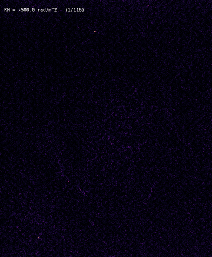

# rmtool

The rmtool package is intended for performing Faraday tomography (or
rotation-measure (RM) synthesis) on radio spectro-polarimetric data.
In addition to processing data from a single contiguous band, rmtool
provides the necessary applications to appropriately combine
heterogeneous multi-band data from different telescopes/bands with
different native projections and angular resolutions. Deconvolution
becomes critical for data sparsely sampled in the spectral domain; the
RM-CLEAN algorithm provided handles this appropriately.

One key motivation for this package is to address Faraday tomography
of the big data cubes that modern observatories are generating at
present. Current packages are unable to handle this data, either
because of the narrow scope they were designed for (i.e. aimed at
small-to-moderate sized data cubes), or because of limited HPC
strategies built into these algorithms. This package addresses both —
every application in it can process large data cubes optimally on
both PCs with small core counts and RAM, as well as HPC-grade nodes
with hundreds of cores and TBs worth of shared memory.

**New here?** → **[QUICKSTART.md](QUICKSTART.md)** builds the tools
and runs a complete match → RM synthesis → RM-CLEAN pipeline end to
end, in a couple of commands.

## Demo

RM-CLEAN's restored output from a WALLABY/EMU multi-band cube reveals line of sight components of the magnetic fields that are in opposite direction at the two edges of this supernova remnant PKS1209-52.

**Highlights**

- **Handles cubes larger than RAM.** Data is processed in tiles sized
  to a user-set fraction of system memory (`mem_frac_ram`) — the same
  config runs on a laptop or an HPC node without need for changes.
- **Multi-band pre-processing built in.** Provides tools for matching
  sky-grid projections between multi-band data, and angular resolution
  across multiple bands as well as across the spectral axis of a
  single band. These two stages can be chained together to avoid
  writing intermediate files, saving huge amounts of disk space for
  large cubes.
- **RM-CLEAN included**, sharing the same tiled, memory-budgeted I/O
  engine as RM synthesis. Correctly handles "gaps" in data due to RFI,
  and from multiple widely separated bands.
- **Parallel, overlapped I/O** for HPC filesystems: multiple concurrent
  read/write channels, with a tile's write overlapped against the next
  tile's read and compute.
- **Optional GPU offload** for the core RM synthesis transform
  (see [GPU Support](#gpu-support)).
- **Configuration files.** Flexible run configuration using plain-text
  `KEY=VALUE` pair files to control memory budget, threading, I/O
  parallelism, GPU use, etc., in addition to RM-synthesis-specific
  parameters.

## What's Included

| Tool | Binary | Does |
|---|---|---|
| RM synthesis | `rm_synthesis` | The core λ²→Faraday-depth transform |
| Reproject | `reproject_cubes` | Aligns cubes onto one common sky grid (WCS reprojection) |
| Convolve | `convolve_cubes` | Convolves cubes to one common angular resolution |
| Match | `match_cubes` | Reproject + convolve chained through memory, no intermediate file |
| RM-CLEAN | `rmclean_cubes` | Högbom-style CLEAN deconvolution of RMSF sidelobes |
| Pipeline | `scripts/run_pipeline.sh` | Chains match → rm_synthesis → rmclean from one config |

## Choosing the Right Tool for Your Data

| Your situation | Run this | Example |
|---|---|---|
| Single band, channels already at consistent resolution, and (if multiple bands) same sky grid | `rm_synthesis` | [EXAMPLES.md §1](docs/user/EXAMPLES.md#1-single-band-quickstart) |
| Different sky grid — one band's pointing vs. another's | `reproject_cubes`, then `rm_synthesis` | [EXAMPLES.md §2b](docs/user/EXAMPLES.md#2b-sky-grid-mismatched-resolution-already-matched--reproject_cubes-only) |
| No existing reference grid to align onto (e.g. a single file, or several with no natural "reference band") | `reproject_cubes`/`match_cubes` with `target_system=` and/or `target_projection=` | [EXAMPLES.md §2b](docs/user/EXAMPLES.md#2b-sky-grid-mismatched-resolution-already-matched--reproject_cubes-only) |
| Different angular resolution — across bands, or across channels of a single band (native beam varies with frequency) | `convolve_cubes`, then `rm_synthesis` | [EXAMPLES.md §2c](docs/user/EXAMPLES.md#2c-resolution-mismatched-sky-grid-already-matched--convolve_cubes-only) |
| Multiple bands, both grid and resolution differ | `match_cubes`, then `rm_synthesis` | [EXAMPLES.md §2d](docs/user/EXAMPLES.md#2d-both-mismatched--match_cubes-chained-through-memory) |
| Need CLEAN deconvolution of a dirty RM cube | `rmclean_cubes` | [EXAMPLES.md §3](docs/user/EXAMPLES.md#3-choosing-rm-clean-stopping-criteria) |
| Want one command for match → rmsynth → rmclean | `scripts/run_pipeline.sh` | [TUTORIAL.md §6](docs/user/TUTORIAL.md#6-running-the-full-pipeline-in-one-command) |

Not sure which case applies? [docs/user/EXAMPLES.md §2](docs/user/EXAMPLES.md#2-multi-band-which-preprocessing-do-i-need) walks through how to tell.

## Quick Start

See [QUICKSTART.md](QUICKSTART.md) — build the tools and run a
complete pipeline end to end in a couple of commands, including
fetching your own data from CASDA. For build requirements and every
build variant, see [BUILD.md](BUILD.md); for the same run explained
step by step, see [docs/user/TUTORIAL.md](docs/user/TUTORIAL.md).

## Configuration

Every tool reads a plain-text `KEY=VALUE` config file (`cfg/`), one key
per line, `#` for comments. Every tool rejects unknown keys and
unparsable values. Repeated keys are handled differently: `rm_synthesis`
rejects them, `reproject_cubes` rejects a key repeated on the command
line, and otherwise a repeated key takes its last value.
[cfg/rmsynth.cfg](cfg/rmsynth.cfg) is a fully annotated template; the
complete key-by-key reference for every tool is in
[docs/user/APP_REFERENCE.md](docs/user/APP_REFERENCE.md).

## GPU Support

`rm_synthesis` can run its core transform on an NVIDIA GPU. There are two
back ends, both built with gfortran:

- **OpenMP target offload** (the default): `make GPU=1 GPU_FC=gfortran`,
  then `use_gpu=y` in the cfg file. It needs gfortran with the NVPTX
  offload compiler (`gcc-offload-nvptx`) and the NVIDIA driver.
- **CUDA** (opt-in): `make GPU=1 GPU_BACKEND=cuda GPU_FC=gfortran`. The
  transform becomes a cuBLAS matrix product. It needs the cuBLAS and CUDA
  runtime libraries as well. The cfg file is the same.

The other four tools have no GPU path. The exact packages are in
[BUILD.md](BUILD.md) and [QUICKSTART.md](QUICKSTART.md#prerequisites).
Set `gpu_vram_mib` to your card's memory: there is no automatic
detection. See
[EXAMPLES.md §6](docs/user/EXAMPLES.md#6-gpu-vs-cpu-which-build-should-i-use)
for timings and for choosing CPU or GPU.

### Tested configurations

Both machines run Ubuntu 24.04 with gfortran 13.3, `gcc-13-offload-nvptx`
and libgomp 14.2.

| | Machine A | Machine B |
|---|---|---|
| GPU | Tesla P100-PCIE-16GB, 16 GiB, compute capability 6.0, PCIe 3.0 x16, driver 580.178.04 | GeForce RTX 3050, 6 GiB, compute capability 8.6, 70 W limit, driver 535.309.01 (PCIe link read at idle: Gen 1 x8, maximum Gen 3 x16) |
| CPU | Xeon E5-2697 v4, 2.3 GHz (3.6 GHz maximum), 18 cores / 36 threads, 45 MiB L3, AVX, AVX2, FMA | Xeon E5-2650 v2, 2.6 GHz (3.4 GHz maximum), 8 cores / 16 threads, 20 MiB L3, AVX only |
| Memory | 62.7 GiB | 62.7 GiB |
| Input cubes on | four 250 GB NVMe drives in RAID0 | SATA SSD (Crucial BX500, 1 TB) |
| Output on | the same RAID0 | NVMe SSD (Crucial P2, 1 TB) |
| System | Ubuntu 24.04.5, kernel 7.0.0-42 | Ubuntu 24.04.4, kernel 6.8.0-139 |
| CUDA libraries | cuBLAS 12.0.2 (`nvidia-cuda-toolkit` 12.0.140) | cuBLAS 12.0.2 (driver supports CUDA 12.2) |

Test: the Q and U cubes of one real observation, 5401 x 5401 pixels x 288
channels (33.6 GB each), giving 168 RM planes, with `gpu_vram_mib=3072`,
`mem_frac_vram=0.5`, `nwriters=4` and `io_read_threads=4`. One run per
case.

| Back end | Machine A: wall time | Machine A: RM compute | Machine B: wall time | Machine B: RM compute |
|---|---|---|---|---|
| CPU, OpenMP (`GPU=0 OMP=1`) | 451 s | 151 s | 930 s | 328 s |
| GPU, OpenMP offload | 132 s | 5.1 s | 484 s | 13.0 s |
| GPU, CUDA | 131 s | 5.1 s | 457 s | 12.9 s |

"RM compute" is the transform itself, from the run's timing summary. The
rest of the wall time is reading the input cubes and writing the output
cubes, which overlap with the compute. On this cube the run is limited by
the disks, not by the GPU: the GPU shortens the compute 30-fold on
machine A and 25-fold on machine B, but the wall time only 3.4-fold and
1.9-fold. Where the output is written
makes a large difference: on machine B, with the output on the SATA SSD
instead of the NVMe drive, the same runs took 1474 s (CPU), 1575 s
(OpenMP offload) and 1533 s (CUDA). On machine A, `gpu_vram_mib=16384`
gave 137 s for the OpenMP back end, so the GPU memory setting changes
little for this cube.

On machine B the GPU back ends agree with the CPU build. A check on the
whole field at every 8th pixel found amplitudes within 2.2e-6 of each
pixel's peak and phases within 0.0034 rad (phases compared as angles).
The test suite has been run on machine A with both back ends; it has not
been run on machine B.

The two GPU back ends were within 6% of each other on this cube (131 s
against 132 s on machine A, 457 s against 484 s on machine B). The OpenMP
back end is the default and needs fewer packages; the CUDA back end also
needs the cuBLAS and CUDA runtime libraries.

## What Your Machine Needs

- **Required:** `git`, `make`, `gfortran`, CFITSIO, FFTW3 and Starlink
  AST, plus `python3` with `venv` and `pip` for the test suite, the
  plotting scripts and `scripts/casda_fetch.py`. `rm_synthesis` by itself
  needs only `gfortran` and CFITSIO; FFTW3 and AST are used by
  `match_cubes`, `reproject_cubes`, `convolve_cubes` and `rmclean_cubes`,
  which the standard workflow runs.
- **Optional:** the NVIDIA offload compiler packages and driver for GPU
  runs of `rm_synthesis`; the CUDA libraries for the opt-in CUDA back
  end.

`./build.sh` checks these and prints the install command for anything
missing; it does not install system packages itself. The exact
`apt-get` lines are in [QUICKSTART.md](QUICKSTART.md#prerequisites).

## Documentation

| Doc | Covers |
|---|---|
| [QUICKSTART.md](QUICKSTART.md) | Build, then run the full pipeline end to end in two commands |
| [BUILD.md](BUILD.md) | Build system details, requirements, release tagging policy |
| [docs/user/TUTORIAL.md](docs/user/TUTORIAL.md) | Step-by-step: build → synthetic data → rm_synthesis → rmclean → inspect output |
| [docs/user/EXAMPLES.md](docs/user/EXAMPLES.md) | Recipes by scenario: single/multi-band, CLEAN stopping criteria, memory/IO tuning, GPU vs. CPU, subimage extraction |
| [docs/user/APP_REFERENCE.md](docs/user/APP_REFERENCE.md) | Full parameter reference for every tool: every key, every default, output files |
| [cfg/CONFIG_README.md](cfg/CONFIG_README.md) | `rm_synthesis` config parser rules |
| [RELEASE_NOTES.md](RELEASE_NOTES.md) | What's in the current release |
| [CHANGELOG.md](CHANGELOG.md) | Version history |

Internal architecture/engineering documentation lives under `docs/dev/`.

## Development

- **Branches:** `main` (stable releases), `develop` (active development).
- **Release tags:** `R`-prefixed `MAJOR.MINOR` on `main` (e.g. `R1.0`).
  See [BUILD.md](BUILD.md#release-tagging-policy) for why the `R`
  prefix.

## License

See [LICENSE](LICENSE). For questions or contributions, please open an issue.

---

*This project was developed with assistance from LLM tools (code
refactorisation, debugging, documentation, and testing support).*
